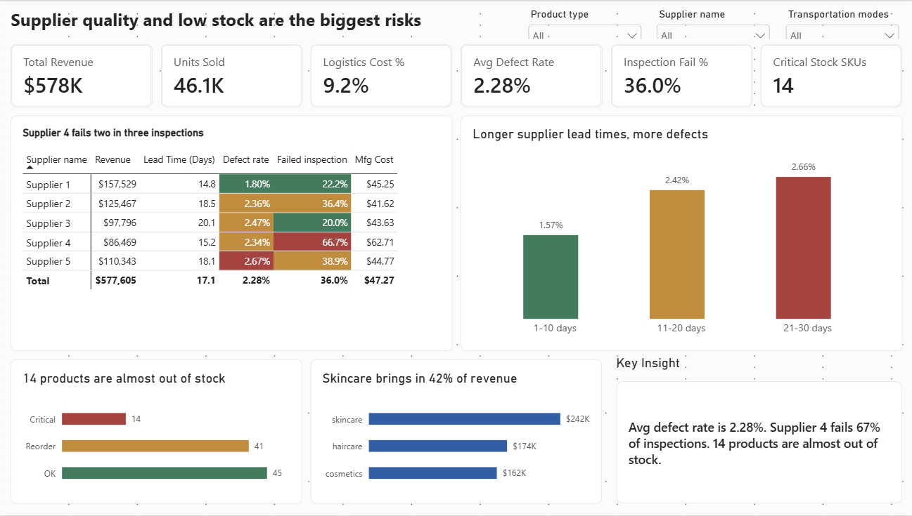
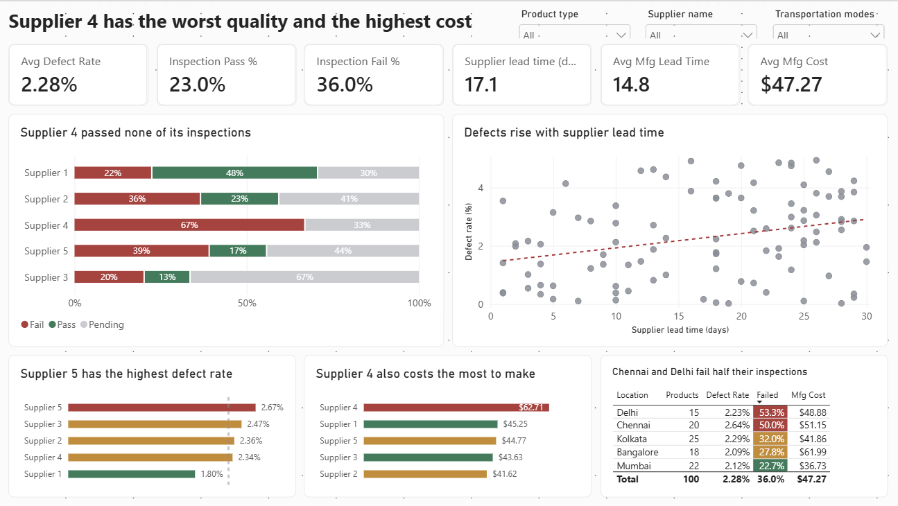
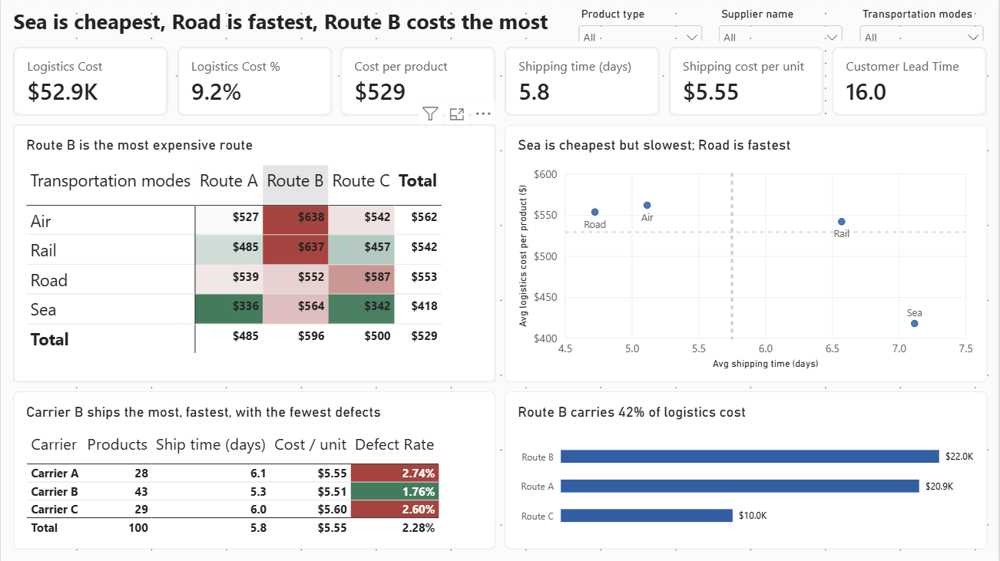
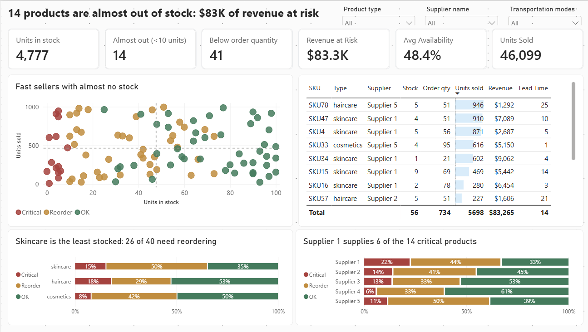

# Supply chain operations dashboard (Power BI)

A four-page Power BI report that answers the questions someone running a supply chain asks every week: which suppliers can I rely on, what's the cheapest way to ship, and what's about to run out?



## In short

- One supplier fails two in three quality inspections and still costs the most to make.
- Products with longer supplier lead times have more defects.
- 14 products are almost out of stock, and some of them are among the best sellers.

## Why I built it

I wanted a dashboard built around decisions rather than totals. Revenue by category is easy to chart, but it doesn't tell an operations manager what to do on Monday morning. This report puts suppliers, shipping and stock on separate pages, and each chart title states what the chart shows.

## The data

`supply_chain_data.csv` is a public Kaggle dataset for a beauty brand: 100 products (skincare, haircare and cosmetics), one row each, with 24 columns covering sales, stock, suppliers, quality inspections and shipping.

**A note on the data.** It's synthetic, and it shows. Revenue doesn't equal price × units sold, and most columns aren't related to each other. With only 100 rows, a group like "Supplier 3" has just 15 products. So I treat everything below as *what the dashboard surfaces*, not as proven conclusions. The point of the project is the method: the model, the measures and the design, which would work the same on real data.

## What the dashboard shows

**1. Supplier 4 has a quality problem.**
12 of its 18 products failed inspection (67%) and none passed. It also has the highest manufacturing cost: $62.71 per unit, against $41–$45 for everyone else.

**2. Longer lead times go with more defects.**
Products with a supplier lead time of 1–10 days average a 1.57% defect rate. At 11–20 days it's 2.42%, and at 21–30 days it's 2.66%. This is the clearest pattern in the dataset.

**3. Supplier 1 is the most reliable, but runs low on stock.**
It has the lowest defect rate (1.80%), the shortest lead time (14.8 days) and the most revenue ($158K). It also supplies 6 of the 14 products that are almost out of stock.

**4. 14 products are almost out of stock.**
These products have fewer than 10 units left and account for $83K of revenue. Some are fast sellers: SKU78 sold 946 units and has 5 left; SKU47 sold 910 and has 4. Another 41 products are below their usual order quantity. Skincare is the least stocked, with 26 of its 40 products needing a reorder.

**5. Shipping is a trade-off.**
Sea is the cheapest way to ship ($418 per product) but the slowest (7.1 days). Road is the fastest (4.7 days). Route B is the most expensive route ($596 per product against $485 on Route A) and carries 42% of logistics cost.

**6. Only 23% of products have passed inspection.**
36% failed and 41% are still pending. Chennai and Delhi fail about half of theirs.

## What I'd do next

1. Hold a quality review with Supplier 4, or move volume away from it. It has the worst quality and the highest cost.
2. Reorder the 14 critical products, starting with the fast sellers at the top of the Inventory table.
3. Ask Supplier 1 about stock levels. It's the best supplier on quality, so running out of its products is the most costly gap.
4. Test moving non-urgent products from Route B to Route A, and from Air to Sea where a slower delivery is acceptable.
5. Clear the 41% of inspections that are still pending, because the real pass rate is unknown until they're done.

## The dashboard

| Page | Question it answers | What's on it |
| --- | --- | --- |
| Overview | How healthy is the supply chain, and where should I look first? | 6 KPI cards, a supplier scorecard with red/amber/green cells, defect rate by lead time, products by stock status, revenue by product type, and a text summary that updates with the filters |
| Suppliers & Quality | Which suppliers can we rely on? | Inspection results by supplier, a lead time vs defect rate scatter with a trend line, defect rate and manufacturing cost by supplier, and a location table |
| Logistics | Which way of shipping gives the best balance of cost and speed? | A cost vs speed scatter by transport mode, a mode × route cost heatmap, a carrier comparison table, and cost by route |
| Inventory | What's about to run out? | A stock vs units sold scatter, a table of critical products sorted by sales, and stock status by product type and by supplier |

| | |
| --- | --- |
|  |  |
|  | |

Design choices I made on purpose:

- Red, amber and green only ever mean bad, watch and good, driven by DAX colour measures. Everything else is grey or blue.
- Chart titles state the finding ("Supplier 4 fails two in three inspections") rather than describing the chart.
- Every page uses the same grid, KPI strip and synced filters (product type, supplier, transport mode).

## How I built it

### Cleaning (Power Query)

- Renamed the table to `SupplyChain`.
- Renamed two confusing columns. "Lead time" became `Supplier Lead Time` and "Lead times" became `Customer Lead Time`. Only the supplier one relates to defects, which is how I worked out which was which.
- Checked the data types. Prices and costs are decimals, and counts are whole numbers.

### Model

One table is plenty for 100 rows. On top of it:

- three calculated columns: `Stock Status` (Critical / Reorder / OK), `Stock Sort` and `Lead Time Band`
- a `_Measures` table with 25 DAX measures
- per-unit columns (shipping cost, manufacturing cost, defect rate, price) set to *Don't summarize*, so they can't be added up by accident

### DAX worth a look

All measures and columns are in [`dax/measures.dax`](dax/measures.dax). These are the ones that did the most work.

**Stock status.** Puts each product into one of three groups, based on how much stock it has compared with its usual order size.
```dax
Stock Status =
SWITCH ( TRUE (),
    SupplyChain[Stock levels] < 10, "Critical",
    SupplyChain[Stock levels] < SupplyChain[Order quantities], "Reorder",
    "OK"
)
```

**Inspection fail rate.** The share of products that failed inspection. It works for any supplier, location or carrier you filter to.
```dax
Inspection Fail % =
DIVIDE (
    CALCULATE ( [SKU Count], SupplyChain[Inspection results] = "Fail" ),
    [SKU Count]
)
```

**Revenue at risk.** Revenue from products that are almost out of stock.
```dax
Revenue at Risk = CALCULATE ( [Total Revenue], SupplyChain[Stock Status] = "Critical" )
```

**Colour rules.** One measure per traffic-light rule, used for conditional formatting across all four pages.
```dax
Fail Colour =
SWITCH ( TRUE (),
    [Inspection Fail %] > 0.45, "#B23A3A",
    [Inspection Fail %] > 0.25, "#C98A2B",
    "#2F7D5B"
)
```

**Text summary.** Writes a one-line summary that changes with the filters.
```dax
Headline Insight =
VAR WorstSupplier =
    MAXX ( TOPN ( 1, ALLSELECTED ( SupplyChain[Supplier name] ), [Inspection Fail %], DESC ), SupplyChain[Supplier name] )
VAR WorstFail = MAXX ( ALLSELECTED ( SupplyChain[Supplier name] ), [Inspection Fail %] )
RETURN
    "Avg defect rate is " & FORMAT ( [Avg Defect Rate], "0.00%" )
        & ". " & WorstSupplier & " fails " & FORMAT ( WorstFail, "0%" ) & " of inspections. "
        & [Critical Stock SKUs] & " products are almost out of stock."
```

## Checking the numbers

I compared the report's totals against the source CSV before building any charts.

| Measure | Value |
| --- | --- |
| Revenue | $577,605 |
| Units sold | 46,099 |
| Logistics cost | $52,925 (9.2% of revenue) |
| Average defect rate | 2.28% |
| Inspections failed / passed / pending | 36% / 23% / 41% |
| Products almost out of stock | 14 |
| Revenue at risk | $83,265 |

## Limitations

- The data is synthetic and small (100 rows). Group differences are worth flagging, but not strong enough to act on alone.
- There are no dates, so I couldn't show trends, seasonality or how stock changes over time.
- "Costs" isn't defined in the source. I treated it as the total logistics cost per product, and Shipping costs and Manufacturing costs as per-unit rates.
- The stock thresholds (under 10 units = critical) are my own choice. A real business would set them from lead times and sales rates.

## What's in this repo

```
├── SupplyChainDashboard.pbix    # the Power BI report
├── data/
│   └── supply_chain_data.csv    # source data
├── dax/
│   └── measures.dax             # all measures and calculated columns
├── images/                      # screenshots of each page
└── README.md
```

## How to open it

1. Install [Power BI Desktop](https://powerbi.microsoft.com/desktop/). It's free, but Windows only.
2. Open `SupplyChainDashboard.pbix`.
3. If it can't find the data, go to Home → Transform data → Data source settings and point it at `data/supply_chain_data.csv`.

**Built with:** Power BI Desktop, Power Query, DAX

**Data source:** [Supply Chain Analysis dataset on Kaggle](https://www.kaggle.com/datasets/harshsingh2209/supply-chain-analysis)
